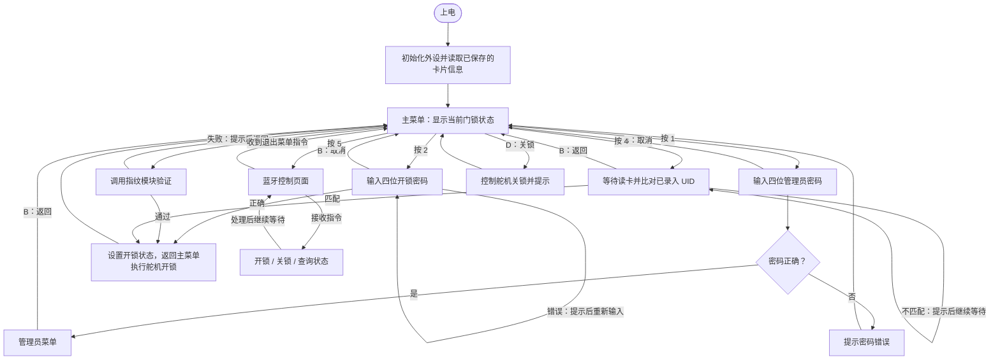
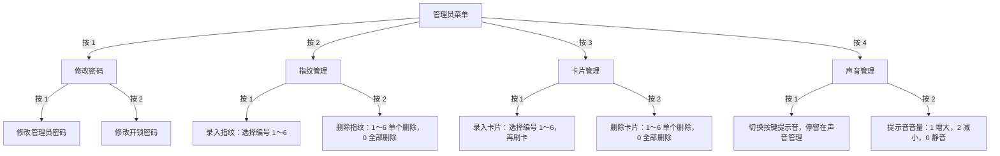
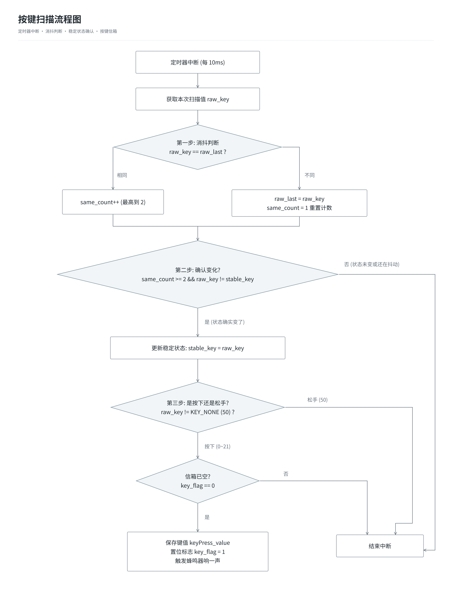
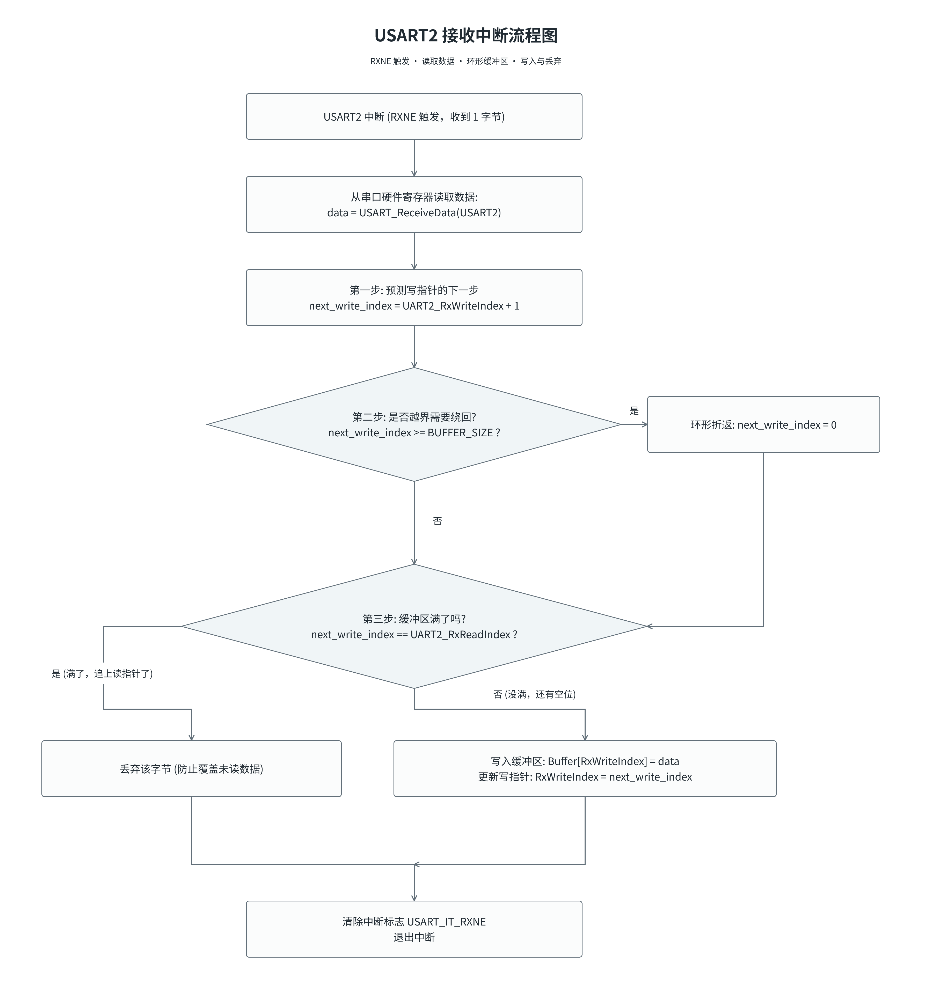
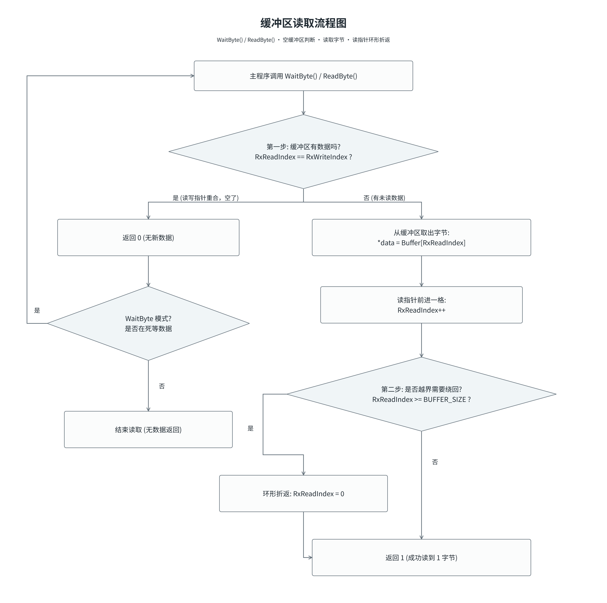

## 项目简介

该项目具有密码开锁、指纹开锁、刷卡开锁、蓝牙开锁的功能。且带语音提示功能，语音的音量可调节；管理员密码与开锁密码可修改，卡片可添加或删除，指纹可添加或删除。

## 硬件清单

主控芯片：STM32F103C8T6；

模块：JM-101指纹模块、ST7735LCD屏幕(1.44寸)、矩阵按键(4×4)、RC522刷卡、JDY-31蓝牙模块、SG90舵机模块、CX1000AM和音箱模块、W25Q64存储模块

## 引脚表

| 模块               | STM32 引脚与连接                                           | 外设 / 说明                    |
| ------------------ | ---------------------------------------------------------- | ------------------------------ |
| JM-101指纹模块     | 模块的RX接PA2，模块的TX接PA3                               | USART2                         |
| ST7735LCD屏幕      | PA15(CS)、PB3(SCL)、PB4(RES)、PB5(MOSI)、PB6(DC)、PB7(BLK) | SPI1                           |
| 矩阵按键           | 行：PA7、PA6、PA5、PA4；列：PB12、PB13、PB14、PB15         | GPIO；TIM1 每 10 ms 扫描与消抖 |
| RC522刷卡          | PA12(CS)、PA8(MOSI)、PB1(MISO)、PA11(SCK)                  | 软件SPI                        |
| JDY-31蓝牙模块     | 模块的RX接PA9、模块的TX接PA10                              | USART1                         |
| SG90舵机模块       | PA0（PWM 输出）                                            | TIM2_CH1                       |
| CX1000AM和音箱模块 | 模块 RX 接 PB10（STM32 TX）；当前程序不使用模块 TX / PB11  | USART3，仅发送语音控制命令     |
| W25Q64存储模块     | PB0(CS)、PA8(MOSI)、PB1(MISO)、PA11(SCK)                   | 软件SPI                        |
| 蜂鸣器             | PC13                                                       | 无                             |

引脚说明：

- 串口的 TX 与对端 RX 相连。指纹模块和蓝牙模块的收发方向如表所示。
- ST7735 使用重映射后的硬件 SPI1：PB3 为 SCK、PB5 为 MOSI、PA15 为 CS。程序关闭 JTAG、保留 SWD，以释放相关引脚；屏幕 RES、DC、BLK 为 GPIO 控制信号。
- RC522 与 W25Q64 共用软件 SPI 的 PA8（MOSI）、PB1（MISO）、PA11（SCK），分别使用 PA12、PB0 作为片选。
- TIM1 用于定时扫描矩阵键盘，TIM2_CH1 用于舵机 PWM，两者用途不同。
- 本表依据当前源码核对；电源、共地及模块工作电压需要结合实际接线确认。

## 菜单流程图

以下按 `代码/智能门禁系统2/User/main.c` 的当前逻辑整理。第一张图表示页面跳转与验证结果，第二张图表示管理员菜单的层级。

### 主菜单与开锁流程



操作说明：

- 主菜单按 `1～5` 进入对应功能；`D` 的键值为 13，用于在主菜单关锁；`B` 的键值为 11，用于支持返回的页面。
- 密码验证失败会继续要求输入；指纹验证失败会返回主菜单；卡片 UID 不匹配会继续等待刷卡。
- 指纹验证页面没有实现按 `B` 返回的分支，验证结束后返回主菜单。
- 蓝牙页面通过串口命令开锁、关锁、查询状态或退出；当前页面没有读取键盘 `B` 的返回分支。开关锁指令在蓝牙页面内执行舵机控制。
- 图中未列出每次 LCD 绘图和语音播报调用，只保留菜单与主要操作流程。

### 管理员菜单层级

管理员密码验证通过后，进入以下菜单。箭头表示进入下一层，返回规则列在图后。



返回与保存规则：

| 页面 / 操作                            | 完成或返回后的去向                                                                       |
| -------------------------------------- | ---------------------------------------------------------------------------------------- |
| 管理员菜单                             | 按 `B` 回主菜单                                                                          |
| 修改密码、指纹管理、卡片管理、声音管理 | 按 `B` 回管理员菜单                                                                      |
| 修改管理员密码、修改开锁密码           | 输入完成后回“修改密码”；按 `B` 取消并回“修改密码”                                        |
| 指纹录入、指纹删除                     | 一次操作后继续显示编号列表；按 `B` 回“指纹管理”                                          |
| 卡片录入                               | 一次录入后继续显示编号列表；等待刷卡时按 `B` 取消本次录入，编号列表中按 `B` 回“卡片管理” |
| 卡片删除                               | 一次删除后继续显示编号列表；按 `B` 回“卡片管理”                                          |
| 提示音音量                             | 调整范围 0～30；按 `B` 回“声音管理”                                                      |

卡片录入、单个删除及全部删除后，程序会将卡片信息写入 W25Q64，开机时读取恢复。当前代码中，两类密码修改只更新 RAM 中的变量，未实现掉电保存。

## 技术设计与调试

### 1. 使用 W25Q64 存储界面图标

**设计原因：** 界面图标采用 45×45 像素的 RGB565 数据，每像素占 2 字节，因此单张图标需要 `45 × 45 × 2 = 4050` 字节。五张图标合计 20250 字节，直接作为常量数组参与编译会占用较多 STM32 片内 Flash。因此，将图标预先写入 W25Q64 外部 Flash，在运行时按需读取。

**实现方式：** 使用宏定义管理各图标在 W25Q64 中的存储地址。显示时，通过软件 SPI 调用 `W64Q25_ReadData()`，将指定地址的 4050 字节读入 RAM 缓冲区 `picture_container`，再调用 `LCD_DrawImageRGB565()`，通过硬件 SPI1 将像素数据发送到 LCD。不同图标共用同一个 4050 字节缓冲区。

```c
// 示例：读取并显示密码图标，函数名沿用现有源码。
W64Q25_ReadData(PICTURE_PASSWORD_45X45, picture_container, 4050);
LCD_DrawImageRGB565(45, 25, 45, 45, picture_container);
```

图标写入外部 Flash 后，关闭 `PICTURE_EN`，使原始图标数组不再参与编译，避免在片内 Flash 中保留同一份图标数据。该方案节省的是图标占用的片内 Flash，运行时仍需 4050 字节的 RAM 缓冲区。

**验证方式：** 开发时，从指定地址读回数据，并将数据值显示在 LCD 上，与写入数据进行检查；随后读取完整图标并显示，以图案显示正确作为存储、读取和显示流程的功能验证。这里描述的是开发时的数据检查与显示观察，未声称完成全部 4050 字节的自动逐字节校验。

### 2. 按键定时扫描与状态消抖

**实现方式：** TIM1 每 10 ms 进入一次更新中断，调用 `Matrix_Key_Scan()` 获取本次原始键值 `raw_key`。将其与上一次扫描结果 `raw_last` 比较：相同则增加 `same_count`（最高计到阈值），不同则更新 `raw_last` 并将计数设为 1。`DEBOUNCE_SAMPLES` 为 2，只有连续两次扫描值相同，才满足稳定判断条件。两次扫描之间间隔 10 ms。

**避免重复上报：** 确认稳定后，还要判断 `raw_key != stable_key`，即是否发生了新的稳定状态变化。首次按下时更新 `stable_key`，持续按住同一个键时状态不再变化，因此不会重复上报。稳定松手时同样更新 `stable_key = KEY_NONE`，但不产生按键事件；之后再次按下同一个键，才能识别为新的按下事件。

**中断与主循环交接：** 使用 `keyPress_value` 保存键值，使用 `key_flag` 表示是否有待处理事件。只有检测到有效按下且 `key_flag == 0` 时，中断才写入键值并置 `key_flag = 1`。主循环读取键值、清除标志并执行对应菜单操作。两个共享变量声明为 `volatile`，用于告知编译器它们可能被中断异步修改。

该交接方式只能保存一个待处理按键事件；邮箱未清空时，新事件不会入队。因此它适用于当前简单菜单操作，不能描述为保证连续快速按键全部不丢失。

#### 流程图



### 3. 指纹 UART 接收与数据包解析

**接收与缓存：** USART2 启用 RXNE 接收中断后，收到字节时由中断读取数据寄存器。中断先计算下一写入位置，索引到数组末尾时回到 0；若下一写入位置不等于读索引，则将字节写入 `UART2_RxBuffer[UART2_RxWriteIndex]` 并更新写索引。缓冲区满时丢弃新字节，避免覆盖未读数据。数组大小为 128 字节，保留一个空位区分空与满，可缓存 127 字节。

**主程序取数据：** `UART_Fingerprint_ReadByte()` 比较读写索引，二者相等表示没有新数据，返回 0；不相等时通过读索引取出一个字节，推进读索引并处理环形回绕，返回 1。`UART_Fingerprint_WaitByte()` 循环调用该接口，直到取得数据，再返回读到的字节值。两者返回值含义不同，`WaitByte()` 返回的是数据，不是 0/1 状态。

**数据包接收与校验：** `JM101_ReceivePacket()` 先寻找 `0xEF 0x01` 包头，再读取四字节地址、一字节包标识和两字节包长度。按高字节在前的方式组合包长度，并根据长度继续接收后续字段（包含末尾两字节校验和）；代码中的整包长度为 `9 + packet_length`。收齐后，从包标识开始累加到校验和之前，得到 16 位累加校验和，与包尾的校验和比较。

校验通过表示满足该协议的校验条件；指纹注册或验证是否成功，还需要解析确认码与返回参数。当前取字节采用阻塞等待，尚未实现接收超时退出；环形缓冲区用于暂存异步到达的数据，容量有限。

#### 流程图：

启用 USART2 的 RXNE 接收中断后，每收到一个字节，按以下流程缓存数据：



主程序从环形缓冲区取数据。下图的 0/1 返回值对应 `ReadByte()`；`WaitByte()` 在无数据时循环等待，取得字节后返回该字节值：


